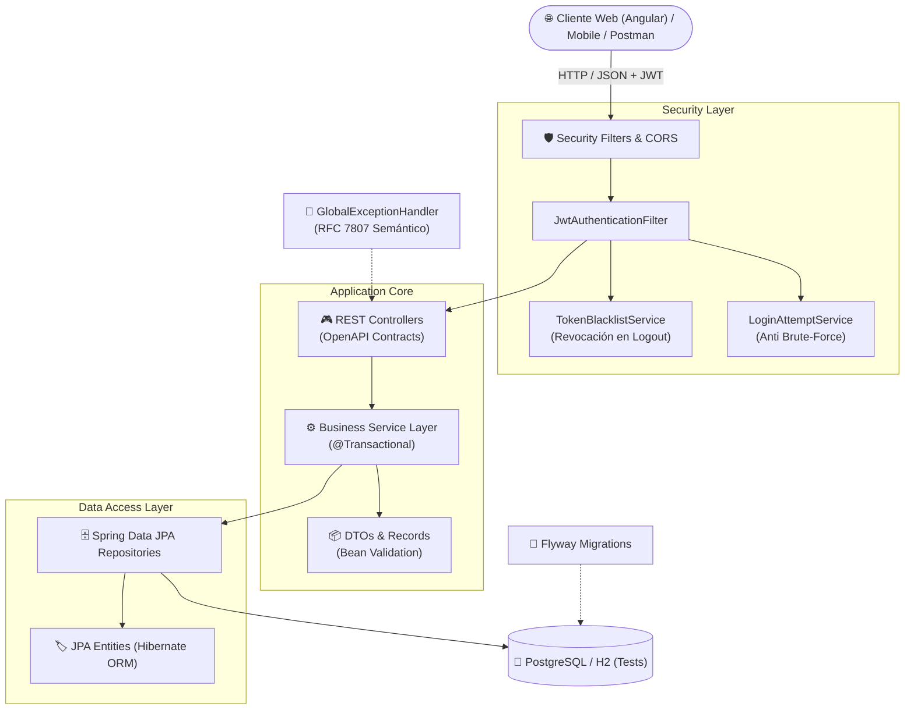

# 🏰 Territorio de Niños — Backend API

<p align="center">
  
  
  
  
  
  
  
</p>

---

## 📌 Descripción General

**Territorio de Niños — API Backend** es una solución robusta y escalable desarrollada en **Java 21** y **Spring Boot 4** para la administración integral de parques infantiles y centros de entretenimiento familiar. 

El sistema centraliza las operaciones críticas del parque: control de acceso seguro mediante roles (RBAC), gestión de atracciones mecánicas e inflables, asignación de operarios en tiempo real, parametrización tarifaria, apertura y arqueo de turnos de caja, y registro de acudientes y menores.

---

## 🏛️ Arquitectura del Sistema

El proyecto sigue una arquitectura en capas desacoplada basada en **Clean Architecture** y principios **SOLID**:



---

## 🧩 Módulos Funcionales

### 1. 🔑 Autenticación & Seguridad Integral
- **Tokens Stateless JWT**: Firma criptográfica HS256 mediante `jjwt 0.12.3`.
- **Revocación Inmediata en Logout**: Servicio [`TokenBlacklistService`](src/main/java/com/software/territoriodeninos/security/TokenBlacklistService.java) en memoria con expiración automática ligada a la vigencia del token.
- **Protección contra Fuerza Bruta**: Bloqueo temporal configurable por IP/usuario ante reintentos fallidos sucesivos con [`LoginAttemptService`](src/main/java/com/software/territoriodeninos/security/LoginAttemptService.java).
- **Recuperación de Credenciales Segura**: Flujo `forgot-password` / `reset-password` mediante tokens UUID con hashing criptográfico SHA-256 en base de datos y purga programada (`@Scheduled`).
- **Verificación de Sesión**: Endpoint `/api/auth/me` para sincronización de perfil y rol en frontend.

### 2. 👥 Gestión de Usuarios & Roles (RBAC)
- Roles predefinidos con granularidad estricta: `ADMINISTRADOR`, `TAQUILLERO`, `OPERARIO`.
- **Protección del Último Administrador**: Regla de integridad que bloquea la desactivación o degradación del único administrador activo del sistema.
- **Borrado Lógico y Auditoría**: Soft-delete (`EstadoUsuario.INACTIVO`) que preserva la integridad referencial histórica de ventas y turnos.

### 3. 🎡 Gestión de Atracciones
- Ciclo de vida y estados operativos: `ACTIVO`, `INACTIVO`, `MANTENIMIENTO`.
- **Integridad Operativa**: Imposibilidad de inactivar o enviar a mantenimiento atracciones que posean operarios activamente asignados en el parque.

### 4. 👷 Asignación de Operarios en Tiempo Real
- Registro y monitoreo de operarios en atracciones con control de hora de inicio y finalización.
- Reasignación forzada segura entre atracciones con cierre automático de la asignación previa.
- Compatibilidad retroactiva de atributos y alias para integración transparente con la interfaz de usuario.

### 5. 💰 Tarifario Flexible
- **Tarifas de Tiempo** (`TarifaTiempo`): Parametrización por minutos/fracciones y precios base.
- **Tarifas de Eventos** (`TarifaEvento`): Paquetes para celebraciones, fiestas infantiles y visitas institucionales.

### 6. ⚙️ Configuración Global del Parque
- Parámetros institucionales: Nombre del parque, NIT, razón social, dirección, teléfono y ciudad.
- Tiempo de gracia configurable para salida y tolerancia de juego.
- Políticas de seguridad y texto legal para tiquetes térmicos (soporte ampliado hasta 2000 caracteres).
- Formato de impresión térmica seleccionable: **58 mm** u **80 mm** con validación estricta.

### 7. 💵 Gestión de Caja, Turnos y Arqueo
- **Apertura de Turno**: Registro de base inicial en efectivo con validación de un solo turno abierto en simultáneo por cajero.
- **Consulta de Turno Activo**: Estado y montos en tiempo real para taquilla.
- **Cierre y Arqueo Ciego**: Comparación entre el monto reportado físicamente y las ventas del sistema (`montoBase + ventasEfectivoSistema`).
- **Regla Financiera Estricta**: Justificación obligatoria en observaciones si se detecta cualquier descuadre (sobrante o faltante).

### 8. 👶 Registro de Clientes y Menores
- Padrón de clientes/acudientes con identificación, contacto y teléfono de emergencia.
- Asociación de menores de edad a cargo, con registro de edad, observaciones médicas y alergias.

---

## 🛠️ Stack Tecnológico

| Componente | Tecnología | Versión | Uso / Justificación |
|---|---|---|---|
| **Lenguaje** | Java OpenJDK | **21 LTS** | Records, Virtual Threads, Pattern Matching y mejoras de rendimiento |
| **Framework** | Spring Boot | **4.0.6** | Núcleo del ecosistema backend |
| **Seguridad** | Spring Security + JJWT | **0.12.3** | Autenticación stateless y RBAC granular |
| **Persistencia** | Spring Data JPA / Hibernate | **7.2.x** | Mapeo objeto-relacional y consultas optimizadas |
| **Base de Datos** | PostgreSQL | **15+** | Motor relacional robusto en producción |
| **Base de Datos (Test)** | H2 Database | **2.4.x** | BD en memoria para tests aislados y rápidos |
| **Migraciones** | Flyway | **11.x** | Versionamiento y reproducibilidad del esquema SQL |
| **Documentación** | Springdoc OpenAPI (Swagger) | **3.1.0** | Documentación interactiva e importación Postman |
| **Generación QR** | ZXing | **3.5.3** | Generación de códigos QR para boletas (RF20) |
| **Exportación** | OpenPDF & Apache Commons CSV | **2.0.3 / 1.11.0** | Generación de reportes imprimibles y exportables |
| **Testing** | JUnit 5 + Mockito + MockMvc | Latest | Pruebas unitarias y de integración end-to-end |
| **Contenedores** | Docker & Docker Compose | 3.8 | Empaquetado portable de base de datos y backend |

---

## 🚀 Puesta en Marcha

### Requisitos Previos
- **Java 21 LTS** instalado (`java -version`).
- **Maven 3.8+** (o utilizar el wrapper incluido `./mvnw`).
- **PostgreSQL 12+** en ejecución local o Docker.

---

### Opción 1: Ejecución Local con Maven

#### 1. Crear la Base de Datos
```bash
psql -U postgres -c "CREATE DATABASE \"territorioNinos\" WITH ENCODING 'UTF8';"
```

#### 2. Configurar Variables de Entorno Mínimas
```bash
export JWT_SECRET="clave_secreta_super_segura_de_al_menos_32_caracteres_123456"
export DB_USERNAME="postgres"
export DB_PASSWORD="tu_password"
```

#### 3. Ejecutar Pruebas Automatizadas
```bash
./mvnw clean test
```

#### 4. Iniciar el Servidor
Mediante script de verificación:
```bash
chmod +x start-app.sh
./start-app.sh
```
O directamente con Maven:
```bash
./mvnw spring-boot:run
```

---

### Opción 2: Ejecución con Docker Compose

Si deseas desplegar todo el entorno (Base de datos PostgreSQL + Backend):

```bash
# Construir e iniciar contenedores
docker-compose up --build -d

# Ver logs de la aplicación
docker-compose logs -f backend
```

---

## 🌐 URLs de Acceso y Servicios

Una vez iniciado el servidor:

| Servicio | URL Local | Descripción |
|---|---|---|
| **API Base Path** | `http://localhost:8080/territorioninos` | Prefijo raíz de todos los endpoints |
| **Swagger UI** | `http://localhost:8080/territorioninos/swagger-ui.html` | Interfaz interactiva de prueba y documentación |
| **OpenAPI Spec (JSON)** | `http://localhost:8080/territorioninos/v3/api-docs` | Esquema OpenAPI para importar en Postman / Insomnia |

---

## ⚙️ Variables de Entorno

| Variable | Descripción | Valor por Defecto (Dev) | Obligatoria en Prod |
|---|---|---|:---:|
| `PORT` | Puerto de escucha HTTP | `8080` | No |
| `DB_URL` | Cadena de conexión JDBC PostgreSQL | `jdbc:postgresql://localhost:5432/territorioNinos` | Sí |
| `DB_USERNAME` | Usuario de base de datos | `postgres` | Sí |
| `DB_PASSWORD` | Contraseña de base de datos | `postgres` | Sí |
| `DDL_AUTO` | Estrategia DDL de Hibernate (`validate`/`update`/`none`) | `update` | Sí (`validate` o `none`) |
| `SHOW_SQL` | Loggear sentencias SQL generadas | `false` | No |
| `JWT_SECRET` | Clave secreta para firma criptográfica HS256 | *Requerida* (mínimo 256 bits) | **Sí** |
| `JWT_EXPIRATION_HOURS` | Tiempo de vida del token JWT en horas | `24` | No |
| `FRONTEND_URL` | URL del cliente frontend para correos de reset | `http://localhost:4200` | Sí |
| `FLYWAY_ENABLED` | Habilitar migraciones automáticas | `true` | No |

---

## 🗃️ Migraciones de Base de Datos (Flyway)

Las migraciones de esquema se gestionan de forma versionada en [`src/main/resources/db/migration`](src/main/resources/db/migration):

- **`V1__remove_edad_atracciones.sql`**: Remoción de columnas deprecadas de edad en atracciones y saneamiento de descripciones.
- **`V2__hardening_integridad.sql`**: Expansión del campo de pie legal de ticket a 2000 caracteres y restricciones de integridad.

---

## 🛡️ Matriz de Permisos & Endpoints de la API

Todos los endpoints (salvo los públicos) requieren el encabezado `Authorization: Bearer <TOKEN>`.

### 🔑 Autenticación (`/api/auth`)
| Método | Endpoint | Descripción | Acceso |
|:---:|---|---|:---:|
| `POST` | `/api/auth/login` | Inicio de sesión y expedición de JWT | 🌐 Público |
| `POST` | `/api/auth/logout` | Cierre de sesión e invalidación de token (Blacklist) | 🔒 Autenticado |
| `POST` | `/api/auth/forgot-password` | Solicitud de token para restablecer contraseña por email | 🌐 Público |
| `POST` | `/api/auth/reset-password` | Restablecimiento de contraseña con token uniuso | 🌐 Público |
| `GET` | `/api/auth/me` | Consulta de datos del usuario en sesión | 🔒 Autenticado |

### 👥 Usuarios (`/api/usuarios`)
| Método | Endpoint | Descripción | Roles Autorizados |
|:---:|---|---|:---:|
| `GET` | `/api/usuarios` | Listar usuarios activos | `ADMINISTRADOR`, `TAQUILLERO`, `OPERARIO` |
| `GET` | `/api/usuarios/{id}` | Obtener usuario por ID | `ADMINISTRADOR`, `TAQUILLERO`, `OPERARIO` |
| `POST` | `/api/usuarios` | Registrar nuevo colaborador | `ADMINISTRADOR` |
| `PUT` | `/api/usuarios/{id}` | Actualizar datos de usuario | `ADMINISTRADOR`, `TAQUILLERO` |
| `DELETE`| `/api/usuarios/{id}` | Inactivar usuario (soft-delete seguro) | `ADMINISTRADOR` |

### 🎡 Atracciones (`/api/atracciones`)
| Método | Endpoint | Descripción | Roles Autorizados |
|:---:|---|---|:---:|
| `GET` | `/api/atracciones` | Listar todas las atracciones | `ADMINISTRADOR`, `TAQUILLERO`, `OPERARIO` |
| `GET` | `/api/atracciones/{id}` | Obtener atracción por ID | `ADMINISTRADOR`, `TAQUILLERO`, `OPERARIO` |
| `POST` | `/api/atracciones` | Crear nueva atracción | `ADMINISTRADOR` |
| `PUT` | `/api/atracciones/{id}` | Actualizar atracción | `ADMINISTRADOR` |
| `PATCH`| `/api/atracciones/{id}/estado` | Cambiar estado (`ACTIVO`/`INACTIVO`/`MANTENIMIENTO`) | `ADMINISTRADOR` |
| `DELETE`| `/api/atracciones/{id}` | Inactivar atracción (valida operarios activos) | `ADMINISTRADOR` |

### 👷 Asignaciones de Operarios (`/api/asignaciones`)
| Método | Endpoint | Descripción | Roles Autorizados |
|:---:|---|---|:---:|
| `GET` | `/api/asignaciones/activas` | Consultar asignaciones vigentes | `ADMINISTRADOR`, `TAQUILLERO`, `OPERARIO` |
| `POST` | `/api/asignaciones` | Asignar operario a atracción (soporta forzado) | `ADMINISTRADOR` |
| `PUT` | `/api/asignaciones/{id}/finalizar` | Finalizar asignación de operario | `ADMINISTRADOR` |
| `DELETE`| `/api/asignaciones/{id}` | Eliminar registro de asignación | `ADMINISTRADOR` |

### 💰 Tarifas de Tiempo y Eventos (`/api/tarifas-tiempo`, `/api/tarifas-evento`)
| Método | Endpoint | Descripción | Roles Autorizados |
|:---:|---|---|:---:|
| `GET` | `/api/tarifas-tiempo` | Listar tarifas por tiempo activas | Todos |
| `POST` | `/api/tarifas-tiempo` | Crear nueva tarifa de tiempo | `ADMINISTRADOR` |
| `PUT` | `/api/tarifas-tiempo/{id}` | Actualizar tarifa de tiempo | `ADMINISTRADOR` |
| `GET` | `/api/tarifas-evento` | Listar tarifas de paquetes/eventos | Todos |
| `POST` | `/api/tarifas-evento` | Crear tarifa de evento | `ADMINISTRADOR` |
| `PUT` | `/api/tarifas-evento/{id}` | Actualizar tarifa de evento | `ADMINISTRADOR` |

### 💵 Turnos de Caja (`/api/turnos`)
| Método | Endpoint | Descripción | Roles Autorizados |
|:---:|---|---|:---:|
| `POST` | `/api/turnos/abrir` | Abrir turno de caja con monto base inicial | `TAQUILLERO`, `ADMINISTRADOR` |
| `GET` | `/api/turnos/activo` | Obtener turno activo del cajero en sesión | `TAQUILLERO`, `ADMINISTRADOR` |
| `PUT` | `/api/turnos/cerrar` | Cierre y balance de caja con arqueo de efectivo | `TAQUILLERO`, `ADMINISTRADOR` |

### 👶 Clientes & Menores (`/api/clientes`)
| Método | Endpoint | Descripción | Roles Autorizados |
|:---:|---|---|:---:|
| `GET` | `/api/clientes` | Buscar/listar clientes y sus menores asociados | `ADMINISTRADOR`, `TAQUILLERO` |
| `POST` | `/api/clientes` | Registrar acudiente con menores a cargo | `ADMINISTRADOR`, `TAQUILLERO` |
| `PUT` | `/api/clientes/{id}` | Actualizar datos de cliente y menores | `ADMINISTRADOR`, `TAQUILLERO` |

---

## 🧪 Pruebas Automatizadas

El proyecto cuenta con una cobertura integral de pruebas unitarias y de integración sobre servicios, entidades, repositorios JPA y controladores web:

```bash
# Ejecutar toda la suite de pruebas
./mvnw clean test

# Ejecutar únicamente las pruebas del módulo de caja
./mvnw test -Dtest=TurnoCaja*

# Ejecutar pruebas de seguridad y autenticación
./mvnw test -Dtest=Auth*
```

---

## 🌿 Convención de Commits

El repositorio sigue de manera estricta la especificación **[Conventional Commits 1.0.0](https://www.conventionalcommits.org/)**:

```text
<tipo>(<ámbito opcional>): <descripción corta en imperativo>

[cuerpo explicativo opcional del por qué del cambio]

[pie opcional con referencias a issues o BREAKING CHANGE]
```

Tipos admitidos: `feat`, `fix`, `refactor`, `test`, `chore`, `docs`, `perf`, `build`, `ci`, `revert`.

---

## 📄 Licencia

Este proyecto es software privado y confidencial desarrollado para **Territorio de Niños**. Todos los derechos reservados.
