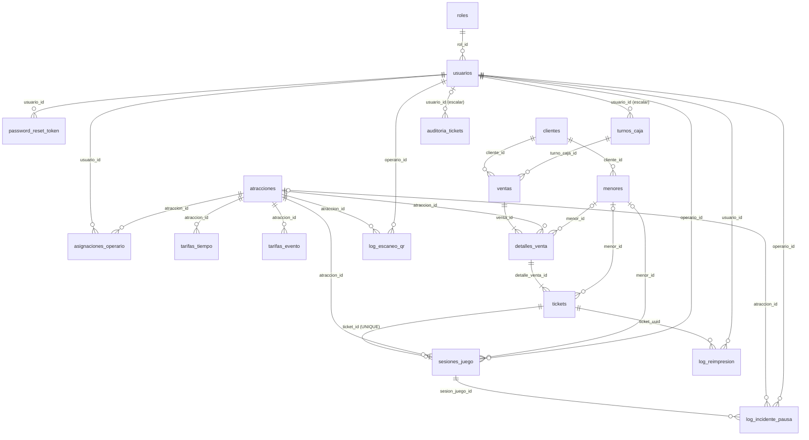

# Esquema de Base de Datos (PostgreSQL + JPA + Flyway)
> Fuente de verdad: `src/main/java/com/software/territoriodeninos/entity/*.java`, `util/*.java`, `config/PostgresConstraintInitializer.java`, `src/main/resources/db/migration/V1..V12__*.sql`. Última sincronización: 2026-11-19 (commit 99cce91).

## 1. Gestión del Esquema y Convenciones
- **Motor:** PostgreSQL (`jdbc:postgresql://localhost:5432/territorioNinos` por defecto en `DB_URL`). En tests se usa H2 en memoria.
- **Estrategia híbrida JPA + Flyway:**
  - `spring.jpa.hibernate.ddl-auto=${DDL_AUTO:update}` crea/actualiza tablas base desde las entidades `@Entity`.
  - `spring.flyway.enabled=${FLYWAY_ENABLED:true}` ejecuta `classpath:db/migration/V1..V12` con `baseline-on-migrate=true` y `baseline-version=0`. Todas las migraciones usan bloques `DO $$ ... IF to_regclass(...) IS NOT NULL` o `CREATE TABLE/INDEX IF NOT EXISTS` para ser 100% idempotentes.
  - `PostgresConstraintInitializer` (`ApplicationRunner`) garantiza al arranque los índices únicos parciales de PostgreSQL (`ux_asignacion_operario_activa` y `ux_turno_caja_usuario_abierto`), omitiéndolos silenciosamente en H2.
- **Claves primarias (PK):**
  - Todas las tablas usan `BIGSERIAL` (`Long` con `GenerationType.IDENTITY`), **excepto** `tickets`, cuya PK es `uuid_codigo` (`UUID` v4 generado por `UUIDGeneratorService` e insertado vía `Persistable<UUID>` para evitar `SELECT` previo al `INSERT`).

---

## 2. Diagrama Entidad-Relación (Mermaid)

---

## 3. Catálogo de Tablas y Entidades JPA

### 3.1 Seguridad y Usuarios
- **`roles`** (`entity/Rol.java`):
  | Columna | Tipo SQL / Java | Null | Notas |
  | :--- | :--- | :--- | :--- |
  | `id` | `BIGSERIAL` / `Long` | NO | PK |
  | `nombre` | `VARCHAR` / `NombreRol` | NO | `UNIQUE`, Enum STRING |
  | `descripcion` | `VARCHAR` / `String` | SÍ | |
  | `fecha_creacion` | `TIMESTAMP` / `LocalDateTime` | NO | `@PrePersist` |

- **`usuarios`** (`entity/Usuario.java`):
  | Columna | Tipo SQL / Java | Null | Notas |
  | :--- | :--- | :--- | :--- |
  | `id` | `BIGSERIAL` / `Long` | NO | PK |
  | `nombre` | `VARCHAR(100)` / `String` | NO | |
  | `correo` | `VARCHAR(100)` / `String` | NO | `UNIQUE` (login principal) |
  | `password` | `VARCHAR` / `String` | NO | Hash BCrypt |
  | `estado` | `VARCHAR` / `EstadoUsuario` | NO | Default `ACTIVO` |
  | `rol_id` | `BIGINT` / `Rol` | NO | FK -> `roles(id)` (EAGER) |
  | `fecha_creacion` | `TIMESTAMP` / `LocalDateTime` | NO | `updatable=false` |
  | `fecha_actualizacion` | `TIMESTAMP` / `LocalDateTime` | SÍ | `@PreUpdate` |

- **`password_reset_token`** (`entity/PasswordResetToken.java`):
  | Columna | Tipo SQL / Java | Null | Notas |
  | :--- | :--- | :--- | :--- |
  | `id` | `BIGSERIAL` / `Long` | NO | PK |
  | `token` | `VARCHAR` / `String` | NO | `UNIQUE`, almacena hash SHA-256 del token enviado por correo |
  | `usuario_id` | `BIGINT` / `Usuario` | NO | FK -> `usuarios(id)` (EAGER) |
  | `fecha_expiracion` | `TIMESTAMP` / `LocalDateTime` | NO | |

### 3.2 Parque, Atracciones, Tarifas y Asignaciones
- **`configuracion_parque`** (`entity/ConfiguracionParque.java`) — Registro singleton (normalmente `id = 1`):
  | Columna | Tipo SQL / Java | Null | Notas |
  | :--- | :--- | :--- | :--- |
  | `id` | `BIGSERIAL` / `Long` | NO | PK |
  | `nombre_parque`, `nombre_comercial`, `razon_social`, `nit`, `direccion`, `telefono`, `ciudad`, `mensaje_pie` | `VARCHAR(255)` | NO (`nombre_parque`, `nit`) / SÍ | Datos fiscales y encabezado de tirilla |
  | `politicas_seguridad` | `VARCHAR(2000)` | SÍ | |
  | `pie_ticket_legal` | `VARCHAR(2000)` | SÍ | Ampliado a 2000 en V2 |
  | `ancho_papel_mm` | `INTEGER` | NO | `58` u `80` (default `80`) |
  | `tiempo_gracia_general_segundos` | `INTEGER` | NO | Default `0` (o `300` en seed) |
  | `aplica_impuesto` | `BOOLEAN` | NO | Default `TRUE` (V4) |
  | `porcentaje_impuesto` | `NUMERIC(5,2)` / `BigDecimal` | NO | Default `0.00` (V4) |

- **`atracciones`** (`entity/Atraccion.java`):
  | Columna | Tipo SQL / Java | Null | Notas |
  | :--- | :--- | :--- | :--- |
  | `id` | `BIGSERIAL` / `Long` | NO | PK |
  | `nombre` | `VARCHAR` / `String` | NO | `UNIQUE` |
  | `descripcion` | `VARCHAR` / `String` | SÍ | |
  | `tarifa_minuto` | `NUMERIC(10,2)` / `BigDecimal` | NO | Precio por minuto base |
  | `estado` | `VARCHAR` / `EstadoAtraccion` | NO | Default `ACTIVO` |
  | `tipo` | `VARCHAR` / `TipoAtraccion` | NO | Default `TEMPORIZADA` |
  | `capacidad_maxima` | `INTEGER` | NO | Default `1` (aforo máximo simultáneo) |
  | `duracion_minutos_base` | `INTEGER` | NO | Default `15` |
  | `tolerancia_minutos` | `INTEGER` | NO | Default `0` |
  | `caidas_limite` | `INTEGER` | NO | Default `3` (para `EVENTOS_CAIDAS`) |
  | `edad_minima`, `edad_maxima` | `INTEGER` | SÍ | Re-añadidas en V8 tras dropearse en V1 |
  | `fecha_creacion` | `TIMESTAMP` / `LocalDateTime` | NO | `updatable=false` |

- **`tarifas_tiempo`** (`entity/TarifaTiempo.java`) y **`tarifas_evento`** (`entity/TarifaEvento.java`):
  | Tabla | Columnas clave | Constraints |
  | :--- | :--- | :--- |
  | `tarifas_tiempo` | `id` (PK), `atraccion_id` (FK -> `atracciones`), `duracion_minutos` (`INTEGER NOT NULL`), `precio` (`NUMERIC(10,2) NOT NULL`), `activo` (`BOOLEAN` default `true`), `fecha_creacion` | `UNIQUE(atraccion_id, duracion_minutos)` |
  | `tarifas_evento` | `id` (PK), `atraccion_id` (FK -> `atracciones`), `intentos` (`INTEGER NOT NULL`), `precio` (`NUMERIC(10,2) NOT NULL`), `activo` (`BOOLEAN` default `true`), `fecha_creacion` | `UNIQUE(atraccion_id, intentos)` |

- **`asignaciones_operario`** (`entity/AsignacionOperario.java`):
  | Columna | Tipo SQL / Java | Null | Notas |
  | :--- | :--- | :--- | :--- |
  | `id` | `BIGSERIAL` / `Long` | NO | PK |
  | `usuario_id` | `BIGINT` / `Usuario` | NO | FK -> `usuarios(id)`. Índice único parcial `WHERE estado = 'ACTIVA'` |
  | `atraccion_id` | `BIGINT` / `Atraccion` | NO | FK -> `atracciones(id)` |
  | `fecha_asignacion` | `DATE` / `LocalDate` | NO | Default `LocalDate.now()` |
  | `hora_inicio` | `TIMESTAMP` / `LocalDateTime` | NO | Default `LocalDateTime.now()` |
  | `hora_fin` | `TIMESTAMP` / `LocalDateTime` | SÍ | Se llena al finalizar o reasignar |
  | `estado` | `VARCHAR(20)` / `EstadoAsignacion` | NO | Default `ACTIVA` |
  | `observaciones` | `VARCHAR(255)` | SÍ | |

### 3.3 Clientes, Caja, Ventas y Tickets
- **`clientes`** (`entity/Cliente.java`) y **`menores`** (`entity/Menor.java`):
  - `clientes`: `id` (PK), `numero_documento` (`VARCHAR(20) UNIQUE NOT NULL`, idx `idx_cliente_documento`), `nombres` (`VARCHAR(100) NOT NULL`), `apellidos` (`VARCHAR(100) NOT NULL`), `telefono` (`VARCHAR(20)`), `correo` (`VARCHAR(100)`), `fecha_registro` (`TIMESTAMP NOT NULL`). Relación `@OneToMany(mappedBy="cliente", cascade=ALL, orphanRemoval=true)` hacia `menores`.
  - `menores`: `id` (PK), `cliente_id` (FK -> `clientes(id) NOT NULL`), `numero_documento` (`VARCHAR(20)`, idx `idx_menor_documento`), `nombre_completo` (`VARCHAR(150) NOT NULL`), `fecha_nacimiento` (`DATE`), `edad` (`INTEGER`), `fecha_registro` (`TIMESTAMP NOT NULL`).

- **`turnos_caja`** (`entity/TurnoCaja.java`):
  | Columna | Tipo SQL / Java | Null | Notas |
  | :--- | :--- | :--- | :--- |
  | `id` | `BIGSERIAL` / `Long` | NO | PK |
  | `usuario_id` | `BIGINT` / `Long` | NO | Escalar (sin `@ManyToOne`). Índice único parcial `WHERE estado = 'ABIERTO'` |
  | `monto_base` | `NUMERIC(12,2)` / `BigDecimal` | NO | Base inicial de apertura |
  | `fecha_apertura` | `TIMESTAMP` / `LocalDateTime` | NO | |
  | `fecha_cierre` | `TIMESTAMP` / `LocalDateTime` | SÍ | |
  | `ventas_efectivo_sistema` | `NUMERIC(12,2)` / `BigDecimal` | SÍ | Calculado al cerrar/arquear (oculto en turno activo por cierre ciego) |
  | `monto_efectivo_reportado` | `NUMERIC(12,2)` / `BigDecimal` | SÍ | Declarado físicamente por el cajero |
  | `diferencia` | `NUMERIC(12,2)` / `BigDecimal` | SÍ | `montoEfectivoReportado - (montoBase + ventasEfectivoSistema)` |
  | `estado` | `VARCHAR(20)` / `EstadoTurnoCaja` | NO | Default `ABIERTO`. Idx compuesto `(usuario_id, estado)` |
  | `observaciones` | `VARCHAR(1000)` / `String` | SÍ | |

- **`ventas`** (`entity/Venta.java`) y **`detalles_venta`** (`entity/DetalleVenta.java`):
  - `ventas`: `id` (PK), `cliente_id` (FK -> `clientes`), `turno_caja_id` (FK -> `turnos_caja`), `monto_total` (`NUMERIC(12,2) NOT NULL`), `subtotal`, `descuento`, `impuestos`, `monto_recibido`, `cambio` (`NUMERIC(12,2)`), `metodo_pago` (`VARCHAR(30)` / `MetodoPago`), `estado_venta` (`VARCHAR(20)` / `EstadoVenta`, default `COMPLETADA`), `fecha_venta` (`TIMESTAMP NOT NULL`), `congelada` (`BOOLEAN NOT NULL DEFAULT TRUE`, V6 — impide alterar tarifas históricas), `observaciones` (`VARCHAR(500)`).
  - `detalles_venta`: `id` (PK), `venta_id` (FK -> `ventas`), `atraccion_id` (FK -> `atracciones`), `menor_id` (FK -> `menores`, nullable), `tipo_tarifa` (`VARCHAR(20)` / `TipoTarifa`), `tarifa_tiempo_id` (`BIGINT`), `tarifa_evento_id` (`BIGINT`), `cantidad` (`INTEGER NOT NULL`), `precio_unitario` (`NUMERIC(12,2) NOT NULL`), `subtotal` (`NUMERIC(12,2) NOT NULL`).

- **`tickets`** (`entity/Ticket.java` implements `Persistable<UUID>`):
  | Columna | Tipo SQL / Java | Null | Notas |
  | :--- | :--- | :--- | :--- |
  | `uuid_codigo` | `UUID` | NO | **PK** (`updatable=false`), generado criptoseguro en `UUIDGeneratorService` |
  | `detalle_venta_id` | `BIGINT` / `DetalleVenta` | NO | FK -> `detalles_venta(id)` |
  | `menor_id` | `BIGINT` / `Menor` | SÍ | FK -> `menores(id)` |
  | `estado_ticket` | `VARCHAR(20)` / `EstadoTicket` | NO | Default `PAGADO` |
  | `fecha_emision` | `TIMESTAMP` / `LocalDateTime` | NO | Default `NOW()` |
  | `fecha_consumo` | `TIMESTAMP` / `LocalDateTime` | SÍ | Añadida en V8; se llena al iniciar o finalizar uso |
  | `hora_ingreso_estimada` | `TIMESTAMP` / `LocalDateTime` | SÍ | Añadida en V10; `NULL` = ingreso inmediato (`AHORA`) |

### 3.4 Operación en Tiempo Real y Auditoría
- **`sesiones_juego`** (`entity/SesionJuego.java`):
  | Columna | Tipo SQL / Java | Null | Notas |
  | :--- | :--- | :--- | :--- |
  | `id` | `BIGSERIAL` / `Long` | NO | PK |
  | `ticket_id` | `UUID` / `Ticket` | NO | `UNIQUE` FK -> `tickets(uuid_codigo)` (1 sesión por ticket) |
  | `atraccion_id` | `BIGINT` / `Atraccion` | NO | FK -> `atracciones(id)` |
  | `menor_id` | `BIGINT` / `Menor` | SÍ | FK -> `menores(id)` |
  | `operario_id` | `BIGINT` / `Usuario` | NO | FK -> `usuarios(id)` |
  | `hora_inicio`, `hora_fin` | `TIMESTAMP` / `LocalDateTime` | NO / SÍ | `hora_fin` calculada para `TEMPORIZADA` |
  | `duracion_segundos` | `INTEGER` | NO | Default `0` |
  | `estado_sesion` | `VARCHAR(30)` / `EstadoSesionJuego` | NO | Default `EN_CURSO` |
  | `tiempo_restante_pausa` | `INTEGER` | SÍ | Segundos congelados al pausar |
  | `fecha_pausa`, `fecha_salida_real` | `TIMESTAMP` / `LocalDateTime` | SÍ | |
  | `segundos_exceso` | `INTEGER` | NO | Default `0` |
  | `intentos_totales`, `intentos_restantes` | `INTEGER` | SÍ | Usados en modo `EVENTOS_CAIDAS` |
  | `alerta_pre_expiracion_enviada`, `alerta_expiracion_enviada` | `BOOLEAN` | NO | Flags usados por `SesionJuegoMonitorScheduler` |

- **Tablas de Auditoría y Trazabilidad:**
  - **`auditoria_tickets`** (`entity/AuditoriaTicket.java`, `@Immutable`): `id` (PK), `ticket_uuid` (`UUID NOT NULL`), `estado_origen` (`VARCHAR(30)`), `estado_destino` (`VARCHAR(30) NOT NULL`), `motivo` (`VARCHAR(500)`), `fecha_evento` (`TIMESTAMP NOT NULL`), `usuario_id` (`BIGINT`), `dispositivo_info` (`VARCHAR(255)`).
  - **`log_escaneo_qr`** (`entity/LogEscaneoQr.java`): `id` (PK), `uuid_leido` (`UUID NOT NULL`), `ticket_encontrado` (`BOOLEAN NOT NULL`), `atraccion_id` (FK), `operario_id` (FK), `direccion_ip` (`VARCHAR(64)`), `timestamp_cliente` (`TIMESTAMP`), `fecha_escaneo` (`TIMESTAMP NOT NULL`), `resultado` (`VARCHAR(40) NOT NULL`: `VALIDO`, `NO_ENCONTRADO`, `YA_CONSUMIDO`, `ATRACCION_INCORRECTA`, `EDAD_FUERA_RANGO`, `AFORO_COMPLETO`), `detalle` (`VARCHAR(500)`).
  - **`log_incidente_pausa`** (`entity/LogIncidentePausa.java`): `id` (PK), `sesion_juego_id` (FK -> `sesiones_juego`), `atraccion_id` (FK -> `atracciones`, V9), `operario_id` (FK -> `usuarios`), `motivo` (`VARCHAR(500) NOT NULL`), `tipo_pausa` (`VARCHAR(50)` default `'OPERATIVA'`, V9), `es_pausa_general` (`BOOLEAN NOT NULL`), `fecha_inicio_pausa` (`TIMESTAMP NOT NULL`), `fecha_fin_pausa` (`TIMESTAMP`), `duracion_segundos` (`INTEGER`).
  - **`log_reimpresion`** (`entity/LogReimpresion.java`, `@Immutable`): `id` (PK), `ticket_uuid` (FK -> `tickets(uuid_codigo)`), `usuario_id` (FK -> `usuarios(id)`), `motivo` (`VARCHAR(500) NOT NULL`), `fecha_reimpresion` (`TIMESTAMP NOT NULL`).
  - **`reportes_atraccion`** (`entity/ReporteAtraccion.java`, V11): `id` (PK), `atraccion_id` (FK -> `atracciones`), `usuario_reporta_id` (FK -> `usuarios`), `tipo_reporte` (`VARCHAR(40)` / `TipoReporteAtraccion`), `severidad` (`VARCHAR(20)` / `SeveridadReporte`), `descripcion` (`VARCHAR(1000)`), `estado` (`VARCHAR(20)` / `EstadoReporteAtraccion`), `atraccion_desactivada` (`BOOLEAN`), `fecha_reporte`, `fecha_resolucion`, `usuario_resuelve_id` (FK -> `usuarios`), `observaciones_resolucion` (`VARCHAR(1000)`).

---

## 4. Diccionario de Enums (`util/*.java`)
| Enum | Valores Exactos | Notas / Alias `@JsonCreator` |
| :--- | :--- | :--- |
| `NombreRol` | `ADMINISTRADOR`, `TAQUILLERO`, `OPERARIO`, `COORDINADOR` | En Spring Security se prefijan con `ROLE_`. |
| `EstadoUsuario` | `ACTIVO`, `INACTIVO`, `SUSPENDIDO` | Usuarios no `ACTIVO` no pueden autenticarse. |
| `EstadoAtraccion` | `ACTIVO`, `INACTIVO`, `MANTENIMIENTO`, `FUERA_DE_SERVICIO` | Acepta alias `"ACTIVA"`, `"INACTIVA"`, `"FUERA DE SERVICIO"`. |
| `TipoReporteAtraccion` | `DANO`, `FALTA_SUPLEMENTOS`, `MANTENIMIENTO_PREVENTIVO`, `OTRO` | Reportes operativos de atracciones (V11). |
| `SeveridadReporte` | `BAJA`, `MEDIA`, `ALTA`, `CRITICA` | Severidad de reportes de atracciones (V11). |
| `EstadoReporteAtraccion` | `ABIERTO`, `EN_PROCESO`, `RESUELTO` | Ciclo de atención de reportes de atracciones (V11). |
| `TipoAtraccion` | `TEMPORIZADA`, `EVENTOS_CAIDAS` | Acepta `"TIME"/"TIEMPO"/"VIP" -> TEMPORIZADA`, `"FALLS"/"CAIDAS"/"EVENTO" -> EVENTOS_CAIDAS`. |
| `TipoTarifa` | `TIEMPO`, `EVENTO`, `MINUTO_BASE` | Acepta variantes con/sin tilde y en inglés. |
| `EstadoAsignacion` | `ACTIVA`, `FINALIZADA`, `REASIGNADA` | Default `ACTIVA`. |
| `EstadoTurnoCaja` | `ABIERTO`, `CERRADO` | Solo 1 `ABIERTO` por `usuario_id`. |
| `EstadoConciliacionTurno` | `CUADRADO`, `SOBRANTE`, `FALTANTE` | Calculado en reportes de cierre de turno. |
| `MetodoPago` | `EFECTIVO`, `TARJETA`, `TARJETA_DEBITO`, `TARJETA_CREDITO`, `TRANSFERENCIA`, `DATAFONO`, `NEQUI`, `DAVIPLATA`, `PSE`, `MIXTO` | Acepta alias `CASH`, `CARD`, `DEBITO`, `CREDITO`, `TRANSFER`, `POS`. |
| `EstadoVenta` | `PAGADO`, `COMPLETADA`, `PENDIENTE`, `ANULADA`, `CANCELADA` | Acepta `"PAGADA"/"EXITOSA" -> PAGADO`, `"COMPLETADO" -> COMPLETADA`. |
| `EstadoTicket` | `PAGADO`, `EN_USO`, `PAUSADO`, `CONSUMIDO`, `VENCIDO`, `ANULADO` | Ciclo normal: `PAGADO -> EN_USO (o PAUSADO) -> CONSUMIDO`. |
| `EstadoSesionJuego` | `EN_CURSO`, `PAUSADA`, `FINALIZADA` | Sincronizado con el estado del `Ticket`. |

---

## 5. Invariantes de Integridad y Reglas de Datos
1. **Concurrencia de Turno de Caja (`ux_turno_caja_usuario_abierto`):** Un `usuario_id` solo puede tener **un** registro en `turnos_caja` con `estado = 'ABIERTO'`. Violaciones disparan `DataIntegrityViolationException` o `TurnoConflictoException` (HTTP 409).
2. **Concurrencia de Asignación de Operario (`ux_asignacion_operario_activa`):** Un `usuario_id` solo puede tener **una** asignación en `asignaciones_operario` con `estado = 'ACTIVA'`.
3. **Unicidad de Tarifas:** `tarifas_tiempo(atraccion_id, duracion_minutos)` y `tarifas_evento(atraccion_id, intentos)` son únicos.
4. **Resolución flexible de QR / Código de Boleta:** Aunque `tickets.uuid_codigo` es un `UUID` completo en BD, los servicios de operación (`OperacionServiceImpl`), consulta (`TicketServiceImpl`) y auditoría (`AuditoriaOperacionServiceImpl`) permiten buscar tanto por UUID completo como por **prefijo corto de 8 caracteres hexadecimales** (ej. `TDN-A1B2C3D4` o `A1B2C3D4`) o documento del cliente/menor.

---

## 6. Historial de Migraciones Flyway (`src/main/resources/db/migration`)
- **`V1__remove_edad_atracciones.sql`**: Elimina temporalmente `edad_minima`/`edad_maxima` de `atracciones` y limpia textos de edad.
- **`V2__hardening_integridad.sql`**: Amplía `configuracion_parque.pie_ticket_legal` a `VARCHAR(2000)` y crea índice único parcial `ux_asignacion_operario_activa`.
- **`V3__turnos_caja_hardening.sql`**: Cierra turnos huérfanos duplicados y crea índice único parcial `ux_turno_caja_usuario_abierto`.
- **`V4__ventas_and_impuestos.sql`**: Añade `aplica_impuesto` y `porcentaje_impuesto` a `configuracion_parque`; crea tablas `ventas` y `detalles_venta` con sus índices.
- **`V5__tickets_table.sql`**: Crea tabla `tickets` con PK `uuid_codigo` e índices por detalle, menor, estado y fecha.
- **`V6__venta_congelada_column.sql`**: Añade columna `congelada BOOLEAN NOT NULL DEFAULT TRUE` a `ventas`.
- **`V7__log_reimpresion_table.sql`**: Crea tabla inmutable `log_reimpresion` e índices por ticket, usuario y fecha.
- **`V8__operacion_fase1_y_base.sql`**: Re-agrega `edad_minima`/`edad_maxima` en `atracciones`, añade `fecha_consumo` en `tickets`, y crea `log_escaneo_qr`, `sesiones_juego` y `log_incidente_pausa`.
- **`V9__reportes_auditoria_y_estadisticas.sql`**: Añade `atraccion_id` y `tipo_pausa` a `log_incidente_pausa`, y crea `auditoria_tickets` con sus índices.
- **`V10__ticket_hora_ingreso_estimada.sql`**: Añade `hora_ingreso_estimada TIMESTAMP` (nullable) a `tickets` para sobreventa con cola FIFO.
- **`V11__rol_coordinador_y_reportes_atraccion.sql`**: Inserta rol `COORDINADOR`, libera constraints CHECK para `FUERA_DE_SERVICIO` y crea tabla `reportes_atraccion`.
- **`V12__restaurar_check_constraints_roles_y_atracciones.sql`**: Recrea de forma idempotente `chk_roles_nombre` (incluye `COORDINADOR`) y `chk_atracciones_estado` (incluye `FUERA_DE_SERVICIO`).
